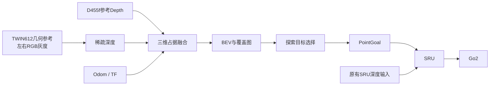

# ThermalNav Demo

C++17 / ROS2 主动探索 Demo：融合 Depth 与双目 RGB 灰度估计的稀疏深度，维护三维占据地图和 BEV，通过现有 Go2 SRU 执行 PointGoal 导航。

## 功能展示

| 功能 | 输出 |
| --- | --- |
| 双目灰度与匹配 | `/thermalnav/stereo/left_gray`、`right_gray`、`matches` |
| 稀疏深度与置信度 | `/thermalnav/stereo/depth_sparse`、`confidence`、`points` |
| 三维占据与二维 BEV | `/thermalnav/occupied_voxels`、`/thermalnav/bev` |
| 相机观测覆盖 | `/thermalnav/coverage` |
| 探索与人员目标 | 候选点、轨迹、目标标记及 `/goal_pose` |
| 对照评测 | `/thermalnav/evaluation`：稀疏深度误差、参考地图完整度、错误自由格数量 |
| 运行状态 | `/thermalnav/status`：输入来源、融合状态、耗时及探索进度 |

## Pipeline



## 使用说明

依赖：ROS2 Humble、OpenCV 开发库、`liboctomap-dev`、`nlohmann-json3-dev`、`libcurl4-openssl-dev`、`ament_cmake_gtest`。

在 `thermalnav_demo` 仓库目录编译与测试：

```bash
bash run_demo.sh build
bash run_demo.sh test
bash run_demo.sh integration-test
```

推荐的硬件参考配置：

| 传感器 | 仿真几何设置 |
| --- | --- |
| D455f Depth | 87°×58°、0.6–6 m；HD 几何以 640×360 渲染 |
| 两只 TWIN612 的 RGB 灰度代理 | 640×512、12 μm 像元、**25 mm 镜头** |
| 热红外双目基线 | **120 mm，仿真暂定值** |

位姿、基线及镜头参数位于 `go2_omniverse/configs/robot_extrinsic.yaml`，可通过 `STEREO_BASELINE`、`THERMAL_LENS_MM` 覆盖。原有 SRU 相机与控制接口保留。

先在另一个终端启动仿真：

```bash
STEREO_RGB=1 CAMERA_RIG=d455f_twin612 bash ../go2_omniverse/commands/run_sim.sh
```

启动建图，再在其他终端查看或启用探索：

```bash
CAMERA_RIG=d455f_twin612 MAPPING_SOURCE=fused bash run_demo.sh observe
bash run_demo.sh rviz
bash run_demo.sh start
bash run_demo.sh status
bash run_demo.sh stop
```

`MAPPING_SOURCE` 可选 `depth_only`、`stereo_only`、`fused`。`CAMERA_RIG=legacy` 使用原前置相机加右目。Go2 仿真保持 `use_sim_time=false`。

建图支路的 Depth 缺失与噪声对照示例：

```bash
CAMERA_RIG=d455f_twin612 MAPPING_SOURCE=fused \
MAPPING_DEPTH_HOLE_FRACTION=0.35 MAPPING_DEPTH_NOISE_SIGMA=0.01 \
bash run_demo.sh observe
```

还可设置 `MAPPING_DEPTH_DROPOUT` 和 `MAPPING_DEPTH_MAX_RANGE`。这些参数只作用于建图输入。

在仿真启动命令中增加 `CAMERA_EVAL_GT=1`，可发布仅供评测的左目深度参考；随后执行 `CAMERA_RIG=d455f_twin612 bash run_demo.sh evaluate` 查看同相机稀疏深度误差及地图指标。

直接探索可使用 `heuristic` 或 `vlm` 命令替代 `observe`。VLM 配置 `THERMALNAV_VLM_URL`、`THERMALNAV_VLM_MODEL` 和可选 `THERMALNAV_VLM_KEY`；YOLO 配置 `THERMALNAV_DETECTOR_ONNX`。

`doctor` 检查原有 SRU 传感器链路；`validate` 和 `manual-check` 在 `observe` 模式下执行探索或 PointGoal 检查。自动启动外部 SRU 的环境可通过 `SRU_SETUP`、`SRU_PYTHON` 指定。
