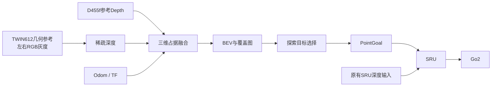
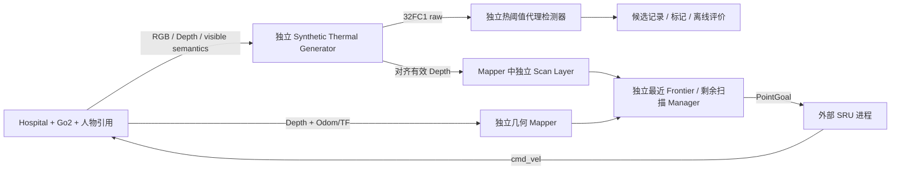

# ThermalNav Demo

C++17 / ROS2 主动探索 Demo：融合 Depth 与双目 RGB 灰度估计的稀疏深度，维护三维占据地图和 BEV，通过现有 Go2 SRU 执行 PointGoal 导航。

当前完成情况、实测结果、未验证功能与剩余阻塞见 [STATUS.md](STATUS.md)。

## 功能展示

| 功能 | 输出 |
| --- | --- |
| 双目灰度与匹配 | `/thermalnav/stereo/left_gray`、`right_gray`、`matches` |
| 稀疏深度与置信度 | `/thermalnav/stereo/depth_sparse`、`confidence`、`points` |
| 三维占据与二维 BEV | `/thermalnav/occupied_voxels` 点云、`/thermalnav/bev` 二维导航 OccupancyGrid |
| 碰撞高度诊断 | `/thermalnav/obstacle_voxels`：与 BEV 使用相同占据阈值和碰撞高度范围 |
| 相机观测覆盖 | `/thermalnav/coverage` |
| 探索与人员目标 | 候选点、轨迹、目标标记及 `/goal_pose` |
| 对照评测 | `/thermalnav/evaluation`：稀疏深度误差、参考地图完整度、错误自由格数量 |
| 运行状态 | `/thermalnav/status`：输入来源、融合状态、耗时及探索进度；`/thermalnav/stereo/status`：双目配对数与阻塞原因 |

## Pipeline



## 使用说明

### Hospital 搜索 Baseline

v1.0 管理器将未下发的候选拒绝与已执行目标失败分别统计。目标按空间位置关联，保留 ACTIVE/REACHED/REJECTED/FAILED/DEFERRED/EXHAUSTED 状态；重复失败受仿真时间冷却限制，地图或机器人位置明显变化后可重新评估。执行只验证当前 SRU 路段，先处理到达反馈，再决定后续路段；到达半径保持 SRU 原有 0.75 m。执行超时、无进展及失败冷却使用 Odom 仿真时间，输入新鲜度使用墙钟时间。

无可执行 Frontier 后进入 `REMAINING_AREA_SCAN`。视点使用实际 CameraInfo/TF 检查地面投影、遮挡和到达范围；没有终端朝向接口时，可用经过相同安全验证的接近路段朝向扫描区域，不新增速度控制。到达后等待真实热代理帧，按目标连通区域的新增扫描格判断收益；无收益记为 `no_coverage_gain`，不再当作有效补扫。没有安全视点时保留覆盖缺口，以 PARTIAL/BLOCKED 结束，只有满足覆盖与目标记录条件才是 COMPLETED。

同一结果目录保留 `metrics.csv`、逐目标/阶段/覆盖采样 `events.jsonl`、带仿真时间戳的 `trajectory.csv`。几何比例分母为配置 ROI 面积；扫描比例分母为当前已建图自由地面，不能解释为全 Hospital 或全部三维空间的搜索覆盖。`BASELINE_METRICS_FILE` 可选择实验目录。已有地图的单独补扫测试可在管理器空闲时调用 `/thermalnav/baseline/scan_remaining`，或用 `BASELINE_INITIAL_STAGE=remaining_scan` 启动；该测试不伪造地图、观测或到达结果。

轨迹发布与地图周期解耦：`/thermalnav/trajectory` 随 Odom 发布，并补上实时末端；历史采样与建图证据不变。RViz 的 Live Robot Odometry 直接订阅 `/robot0/odom`，不会等待新地图才更新。

新启动仿真可添加 `SIM_ONLY_SAFETY_ORACLE=1` 自动加载安全校验器；已有仿真可在 Script Editor 中加载独立脚本，无需重启。探索侧显式设置 `BASELINE_SAFETY_MODE=sim_only_safety_oracle`，两侧均未启用时保持原 Depth 安全约束。

启动安全默认仍为 `depth_only`，Unknown footprint 会停止探索。仿真专用的 `BASELINE_SAFETY_MODE=sim_only_safety_oracle` 可对有限 Frontier/检查候选的扫掠区域使用独立 PhysX 校验；必须先在正在运行的 Isaac Script Editor 加载 `go2_omniverse/core/sim_safety_oracle.py`。它只检查请求路径（每段不超过 6 m），验证机身碰撞高度带与地面支持；候选路径认证只进入管理器的安全证明，不写入地图。已执行位姿可通过下述独立通行证据进入导航 Occupancy；不会成为相机观测、Explored、Thermal Coverage 或信息增益。启动 footprint 证书固定于认证位置；后续路径需独立验证且证明过期/越界/出现新障碍立即取消目标。这是显式使用仿真几何的测试模式，不能报告为纯 Depth 探索或真机方案。

RViz 主地图为原生 OccupancyGrid，交互方式对齐本工作空间 Point-LIO 的 `XYOrbit`：滚轮/右键拖动缩放、左键拖动旋转、中键拖动平移。工具栏默认 MoveCamera，提供选择、聚焦和距离测量；Views 面板保存 `2D BEV - top down`（左键平移）和 `3D Occupancy - orbit` 两种视图。RGB BEV、Coverage 和双目匹配图像仍可用 `Add → By topic` 添加，通用配置默认不创建这些预览窗格；Hospital 配置另有独立的 BEV Decision Image 预览，主视图仍是原生 OccupancyGrid。当前传感器与地图实际在 `odom`，保持该 Fixed Frame；Point-LIO 的 `camera_init` 必须有真实 TF 才能叠加，不能用虚假的单位变换对齐。

适配 [Tavasoli et al., DOI:10.1111/mice.13319](https://doi.org/10.1111/mice.13319) 的高层流程：最近 Frontier 聚类 → 无可执行 Frontier 后检查最近未扫描区域。距离采用安全可行路径长度；聚类中心投影到可达自由空间，检查区观察点需要二维无遮挡视线。使用 Go2、Depth、SRU 和前向语义合成热图，替代论文的 MAV、2D LiDAR、RRT*/DWA 和向下热相机，因此不是整套无人机系统的原样复现。Baseline 不调用 VLM、不按信息增益排序，也不因发现人员改变目标优先级。



按顺序在不同终端运行；已有仿真运行时不要再启动第二个仿真：

```bash
# go2_omniverse：引用本地人物资产，三人在不同房间，一人在入口空地。
HOSPITAL_PEOPLE=1 SIM_ONLY_SAFETY_ORACLE=1 SKIP_ROS_BUILD=true bash commands/run_sim.sh
# thermalnav_demo：只通过 ROS 2 与仿真和 SRU 通信。
bash run_demo.sh build
BASELINE_SAFETY_MODE=sim_only_safety_oracle bash run_demo.sh hospital-baseline
bash run_demo.sh doctor
bash run_demo.sh rviz
# 单独的评价进程读取 GT；运行中的策略和检测器不读取 GT。
bash run_demo.sh baseline-evaluate
bash run_demo.sh stop
```

`config/hospital_baseline.yaml` 配置 ideal/noisy/challenging 合成模式、类别响应、噪声、模糊、降采样、热阈值、搜索 ROI 与输出路径。默认使用原 `front_cam` 的 640×360 同视角 RGB/Depth/Semantic/标签表，四者严格同时间戳，TF 按帧时间查询；它不代表 TWIN612 光谱或噪声物理模型。`/thermalnav/thermal/raw` 为浮点代理信号，`colorized` 仅用于显示；独立检测器只订阅 raw、对齐 Depth/CameraInfo 和 TF，输出 `hot_mask`、JSON `boxes`、`detections` 和 `markers`，不订阅语义或人物 GT。可疑目标按掩码内有效深度定位，多帧关联；阈值检测对其他暖物体可能误检，不是 Thermal YOLO 性能。

Mapper 在此模式仅建图，原 RGB HOG 与内嵌探索禁用。`/thermalnav/scan_mask` 的 -1/0/100 分别表示未定义扫描区域、已建图自由但未扫描、已有效扫描；几何障碍仍由 `/thermalnav/bev` 表达。扫描只按真实可见深度更新地面平面，不按轨迹填充，不表示全部三维遮挡空间已检查。未知净空和未知 footprint 保留，若无安全初始路径，Manager 会以 `BLOCKED` 停止并保留覆盖缺口，不强行移动。

建图证据分别保留相机三维射线净空、可靠地面、占据、近场推断与已验证通行。`/thermalnav/camera_observed_free` 仅发布具有地面及完整碰撞高度净空证据的自由格；`/thermalnav/verified_traversed` 仅发布与 Odom 时间戳、位置严格匹配且通过 PhysX 碰撞/地面支持检查的实际历史 footprint 内完整栅格，不在位姿之间插值，也不采用候选路径的未来采样点。后者需显式启用 `verified_traversal_mode:=sim_only_safety_oracle`（默认 disabled；Hospital 启动脚本跟随 `BASELINE_SAFETY_MODE`），已观测障碍始终优先。`/thermalnav/bev` 融合可信自由证据供导航使用，`/thermalnav/explored` 继续区分真实相机观测与近场推断。上方净空未观测、真实遮挡或没有认证的历史区域保留 Unknown。占据融合采用进入 0.65、退出 0.45 的滞回，单次清空射线不会直接抹除可靠障碍。

实时决策显示独立于选点与 SRU：`/thermalnav/exploration/decision_trace` 发布实际候选、拒绝原因、验证路径距离及选中 ID；独立可视化节点以 2 Hz 发布 `/thermalnav/exploration/markers` 与 `/thermalnav/bev/decision_image`。浅绿表示原始 Frontier，鲜绿表示可达候选，红色标注拒绝原因，金色标出选中目标，青色表示补扫视点。虚线仅表达机器人与目标的选择关系；紫色 `/thermalnav/exploration/selected_path` 是经过检查的高层候选路径，不是 SRU 预测轨迹。原始 OccupancyGrid 和 XYOrbit 主视图保留，辅助图像不会修改导航地图。

独立的 `/thermalnav/baseline/coverage_gaps` 仅用于诊断，-1/0/50/75/100 表示未知、已扫描、未扫描、无安全可执行视点的扫描缺口、几何障碍；它不作为规划 Occupancy 输入。75 表示当前安全证据下被阻塞，不能解释为已经证明物理上永远不可观测。

`/thermalnav/baseline/status` 发布状态与阻塞原因。`/tmp/thermalnav_baseline/metrics.csv` 包含 ROI 几何覆盖、已建图自由地面的热扫描比例、未扫描面积、未建图 ROI、阻塞扫描缺口、时间、路径、栅格重入近似冗余路径、确认候选数和失败目标。`baseline-evaluate` 另存带全场景人员召回率/XY 定位误差的 evaluated CSV，以及从渲染语义像素和深度得到的独立可见性记录；未访问房间中的人物仍计入召回率分母。所有指标仅用于本合成代理实验。

当前位姿接口使用 `/robot0/odom` 与 `odom → camera` TF；未来 Point-LIO/FAST-LIO2 应由独立节点提供相同坐标契约或 ROS 适配器，不引入跨工程源码 import。SRU 仍使用既有 PointGoal 接口：目标以 odom 世界坐标发布，到达依据其既有 0.75 m 阈值和零速度观测，失效/超时发送当前位置目标取消；此部署模型不需要 Route，未关闭任何必需输入。

依赖：ROS2 Humble、OpenCV 开发库、`liboctomap-dev`、`nlohmann-json3-dev`、`libcurl4-openssl-dev`、`ament_cmake_gtest`。

在 `thermalnav_demo` 仓库目录编译与测试：

```bash
bash run_demo.sh build
bash run_demo.sh test
bash run_demo.sh integration-test
```

推荐的硬件参考配置：

| 传感器 | 仿真几何设置 |
| --- | --- |
| D455f Depth | 87°×58°、0.6–6 m；HD 几何以 640×360 渲染 |
| 两只 TWIN612 的 RGB 灰度代理 | 640×512、12 μm 像元、**25 mm 镜头** |
| 热红外双目基线 | **120 mm，仿真暂定值** |

位姿、基线及镜头参数位于 `go2_omniverse/configs/robot_extrinsic.yaml`，可通过 `STEREO_BASELINE`、`THERMAL_LENS_MM` 覆盖。原有 SRU 相机与控制接口保留。

先在另一个终端启动仿真：

```bash
STEREO_RGB=1 CAMERA_RIG=d455f_twin612 bash ../go2_omniverse/commands/run_sim.sh
```

启动建图，再在其他终端查看或启用探索：

```bash
CAMERA_RIG=d455f_twin612 MAPPING_SOURCE=fused bash run_demo.sh observe
CAMERA_RIG=d455f_twin612 bash run_demo.sh rviz
CAMERA_RIG=d455f_twin612 bash run_demo.sh stereo-status
bash run_demo.sh start
bash run_demo.sh status
bash run_demo.sh stop
```

`/thermalnav/bev` 是二维导航 OccupancyGrid；`/thermalnav/occupied_voxels` 是概率阈值以上的三维占据体素，包含观测到的地面表面，不能与 BEV 自由格逐格对照。两者同时显示时点云可能遮住地图。RViz 主地图使用 `/thermalnav/bev` OccupancyGrid。启动 `bash run_demo.sh rviz` 时，RGB proxy 会按 `CAMERA_RIG` 自动映射到对应左目：`legacy` 使用 `/robot0/front_cam/rgb`，`d455f_twin612` 使用 `/robot0/twin612_left/rgb`。BEV RGB 图像不再默认创建独立窗格，可通过 Add → By topic 添加，避免与主地图混淆。双目显示 `No Image` 时运行 `bash run_demo.sh stereo-status`：它检查前端节点和四个输入话题，并显示状态中的配对/时间戳/TF 阻塞原因。若状态有配对但 RViz 仍无图，再检查 RViz Image display 的 Topic 和 QoS。

`MAPPING_SOURCE` 可选 `depth_only`、`stereo_only`、`fused`。`CAMERA_RIG=legacy` 使用原前置相机加右目。Go2 仿真保持 `use_sim_time=false`。

`fused` 启动时要求左右图像与标定均有发布者，并核对已运行双目前端的四个输入参数；运行中断流允许显式 Depth 回退。配置 `fused` 不表示每帧都使用双目：查看 `/thermalnav/status` 的 `bev.sources`、`stereo_points` 与 `fused_two_sources`。空匹配不会成为有效双目证据。图像输入使用与 Isaac 发布端匹配的 Reliable QoS，保留严格同时间戳配对；`stereo/status` 区分缺图、缺标定、时间不配对、TF 等待、低纹理、零有效匹配和断流。

原前置 `/robot0/front_cam/depth` 独立送入 SRU，建图退化参数只修改 mapper 内部副本。当前 Go2 前置相机与 B2W 训练 RayCaster 的视场和安装位置不同，缩放到 64×40 不会消除这种差异。SRU 的 5 Hz 按仿真时间执行；相机渲染负载降低仿真推进率时，墙钟指令频率也会下降。BEV 使用固定地面高度和单层碰撞高度带，对坡面、楼梯和多层空间仍有限制；未知净空保留为未知。

建图支路的 Depth 缺失与噪声对照示例：

```bash
CAMERA_RIG=d455f_twin612 MAPPING_SOURCE=fused \
MAPPING_DEPTH_HOLE_FRACTION=0.35 MAPPING_DEPTH_NOISE_SIGMA=0.01 \
bash run_demo.sh observe
```

还可设置 `MAPPING_DEPTH_DROPOUT` 和 `MAPPING_DEPTH_MAX_RANGE`。这些参数只作用于建图输入。

在仿真启动命令中增加 `CAMERA_EVAL_GT=1`，可发布仅供评测的左目深度参考；随后执行 `CAMERA_RIG=d455f_twin612 bash run_demo.sh evaluate` 查看同相机稀疏深度误差及地图指标。

直接探索可使用 `heuristic` 或 `vlm` 命令替代 `observe`。VLM 配置 `THERMALNAV_VLM_URL`、`THERMALNAV_VLM_MODEL` 和可选 `THERMALNAV_VLM_KEY`；YOLO 配置 `THERMALNAV_DETECTOR_ONNX`。

`doctor` 检查原有 SRU 传感器链路；`validate` 和 `manual-check` 在 `observe` 模式下执行探索或 PointGoal 检查。自动启动外部 SRU 的环境可通过 `SRU_SETUP`、`SRU_PYTHON` 指定。

SRU 默认使用 `baseline`，对应 `sru_test` 已记录 GT Depth PointGoal 测试的 `b2w_navigation_ppo/2026-10-27_01-22-52_b2w_ppo_full/model_5000.pt`，通过部署工程现有 `nav_policy_baseline.onnx` 推理。导出旁的 JSON 记录原 checkpoint SHA-256。`config/sru_pointgoal.yaml` 固定 5 Hz、横向倍率 1.0、三轴新指令滤波权重 0.5，目标高度使用机身世界高度。训练中的随机延迟、噪声、动作偏置和滤波随机化不等同于这个确定性部署配置，B2W 到 Go2 的相机和运动差异仍需闭环验证。可用 `SRU_POLICY_VARIANT=safety` 选择后续 `model_2999.pt` 导出，或显式指定 `original`。复用已有 SRU 时会核对 `policy_variant`，不匹配则报错；复用外部节点时还需确认其参数与该 YAML 一致。模型切换需重启 SRU；这与 Go2 的 Isaac Lab 底层行走策略独立。
