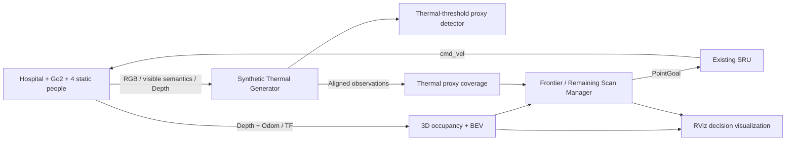

# ThermalNav Demo — Current Status

Updated: **2026-11-13**. This document describes the server source snapshot and its validation status. The Git history identifies the published revision.

**Current outcome:** Hospital Frontier exploration works in simulation. The remaining-area inspection implementation has been improved and unit-tested, but a successful inspection with actual coverage gain and a complete two-stage search have **not** been demonstrated. Isaac Sim, ThermalNav-owned nodes, SRU, and the ThermalNav RViz window were stopped at the user's request.

## Scope and architecture

The current experiment adapts the high-level two-stage search strategy of *Autonomous Post-Disaster Indoor Navigation and Survivor Detection Using Low-Cost Micro Aerial Vehicles* (DOI: 10.1111/mice.13319). It uses Go2, Depth, SRU, and a forward-facing synthetic thermal proxy. It is not a complete reproduction of the paper's MAV system or a validation of real thermal-camera performance.



- `go2_omniverse`: simulation, Hospital, people, sensor rendering, Go2 locomotion, and ROS interfaces.
- `thermalnav_demo`: independent C++ perception, mapping, exploration, visualization, and evaluation nodes.
- `sru-robot-deployment`: existing SRU inference and velocity generation. No new velocity controller was added.
- Modules communicate through ROS 2 topics and TF; no cross-project internal source imports are required. No SLAM or VLM is needed for this Baseline.
- Simulator-side person injection, aligned semantic publishing, and the PhysX safety service must be available in the separate `go2_omniverse` installation. This Demo update does not bundle or publish changes to that repository.

## Completed and validated

| Component | What has been demonstrated | Limits |
| --- | --- | --- |
| Hospital and people | Existing Hospital scene; four static people: one near the entrance and three in rooms; visible semantic labels | Layout unchanged during the latest fixes |
| Synthetic thermal | Aligned RGB, visible semantics, and Depth produce floating-point thermal proxy signals and separate display images | Semantic-conditioned proxy, not physical thermal radiation simulation |
| Detection and localization | Thermal-threshold candidates, depth association, map-frame localization, and temporal association | One unique scene person detected in recorded runs; proxy tracks can duplicate a person under partial visibility |
| Geometry mapping | Timestamped Depth projection, 3D rays, world-height classification, persistent occupancy, BEV, and obstacle-preserving fusion | Unknown ground/clearance and genuine occlusions remain; fixed floor/single collision-height band limits stairs and multiple levels |
| Near-field completion | Connected to the actual fusion path; bounded inferred/explored evidence with obstacle stopping | Does not turn inferred space into camera-verified Free |
| Verified traversal | Actual Odom-matched PhysX-certified footprint cells stored separately; occupied evidence wins; no interpolation between unverified poses | Explicit `sim_only_safety_oracle` mode, disabled by default; not Depth evidence or Thermal Coverage |
| Frontier navigation | Autonomous Frontier selection → safety validation → SRU → Go2 → map update → next goal | Successful Frontier navigation does not imply completed search |
| Goal lifecycle | Candidate rejection separated from navigation failure; spatial association, failure cooldown, segment validation, arrival handling, and simulation-time budgets | Longer search stability and complete coverage remain open |
| RViz decisions | Actual subscription and window visibility confirmed: raw/reachable/rejected candidates, reasons, robot, trajectory, person markers, and decision summary; XYOrbit retained | Latest inspection execution and selected-label changes still need a new live run |
| Decision consistency | Recorded active goal snapshots matched `/goal_pose` in 9/9 checks; 70 obsolete Marker deletions observed | Evidence belongs to the earlier live visualization run, not the unexecuted latest inspection changes |

The Hospital run uses the original `front_cam` RGB-D/semantic view and **depth-only mapping**. Stereo estimation and fusion code exist and have synthetic tests, but the current Hospital results do not establish successful D455f/TWIN612 stereo-fused closed-loop operation. A `fused` configuration alone is not proof that two sources contributed.

SRU remains the `sru_test`-derived baseline `model_5000` deployment: original `/robot0/front_cam/depth`, 5 Hz inference in simulation time, lateral scale 1.0, and nominal filtering. The network, weights, and low-level controller were not changed. Its PointGoal callback uses position; it does **not** enforce terminal yaw.

## Recorded live results — separate experiments

Do not sum these runs or treat their different maps as a controlled before/after comparison.

| Metric | Mapping/navigation regression | Later bounded regression |
| --- | ---: | ---: |
| Frontier goals reached | 10 | 4 |
| Inspection goals reached | 0 | 0 |
| Path length | 10.81 m | 3.46 m |
| Navigation failures / timeouts | 0 / 0 | 0 / 0 |
| Candidate rejections | 10 | 17 |
| Mapped area inside search ROI | 45.48 m² | 29.68 m² |
| Geometric coverage, ROI = 228 m² | 19.95% | 13.02% |
| Thermal proxy scanned area | 17.23 m² | 6.99 m² |
| Scan fraction of currently mapped free ground | 58.39% of 29.51 m² | 53.81% of 12.99 m² |
| Remaining unscanned free ground | 12.28 m² | 6.00 m² |
| Reported person candidates | 1 | 1 |
| Outcome | PARTIAL: scan stage entered, no executable inspection viewpoint | Budget-ended PARTIAL; retained status later changed to STOPPED after time rewind |

The full-scene person evaluation denominator is four. Earlier independent evaluation matched one unique person (25% recall); detector-track counts alone must not be reported as unique-person recall. Scan fractions above are ground-plane proxies, not whole-Hospital or complete 3D human-search coverage.

A separate **same-frame evidence-layer comparison** increased Free from 32.61 to 35.94 m² by adding verified traversal, while Occupied stayed at 71.69 m². All 483 certified cells were Free after fusion. This is not an old-code/new-code full-run comparison and does not justify filling other Unknown cells.

## Latest Remaining Area Scan changes — implemented, not live-validated

Changes are concentrated in `include/thermalnav/baseline_search.hpp`, the Candidate data structure, `src/hospital_baseline_node.cpp`, `src/decision_view.cpp`, and corresponding tests:

1. Sample across an entire unscanned connected component instead of using only the 32 points nearest its center.
2. Generate footprint-aware obstacle-avoiding route proposals using an eight-connected shortest-path search, with diagonal corner-cut prevention and exact swept-obstacle checks.
3. Permit Unknown route proposals only under explicit simulation-oracle mode. Every executed path still requires the existing live safety validation; no map cell is made Free by proposing a route.
4. Carry an intended inspection yaw and arrange an approach leg when needed. This remains a position-only SRU execution strategy, not guaranteed terminal-yaw control.
5. Follow the routed approach with dense subgoals instead of cutting directly to the approach endpoint.
6. Associate coverage gain with the component containing the selected target cell, rather than the nearest component centroid.
7. Record desired/actual yaw, actual target visibility, and measured inspection coverage gain. Reset the scan-test budget when explicitly restarting the scan test.
8. Include actual path distance in the selected-candidate label.

Offline testing on a captured real map generated inspection proposals where the earlier implementation generated none. **These proposals were not subsequently executed in Isaac Sim. No new inspection arrival or coverage gain may be claimed.**

## Validation evidence

- Latest build: **PASS**.
- Latest unit tests: **79 passed** — 31 core, 25 stereo/fusion, 19 Hospital Baseline, and 4 decision visualization tests.
- Three isolated ROS integration tests passed on **2026-11-12**, before the latest inspection changes. They were **not rerun** after those changes.
- Latest inspection navigation, actual inspection coverage gain, and full two-stage closed loop: **NOT TESTED**.
- Existing SRU configuration and Hospital-person configuration hashes were unchanged.

Compact evidence remains under `/tmp/thermalnav_mapping_validation/`, `/tmp/thermalnav_mapping_final/`, and `/tmp/thermalnav_cpp_build_colcon_1001/thermalnav_demo/test_results/`. These are server-local temporary paths, not durable repository artifacts. CSV/JSONL record metrics, decisions, outcomes, stages, and trajectory samples.

## Current blockers and next validation

1. **Simulation clock mismatch:** after a long run, Depth timestamps were approximately 21334 s while Odom/TF were approximately 1334 s: an observed 20000 s offset. Mapping and detection could no longer obtain matching pose/TF. The source-time recovery was not completed before the user requested shutdown. Do not compensate with arbitrary offsets or looser synchronization.
2. **Inspection execution:** after restoring consistent sensor/Odom/TF time, test `remaining_scan` on a real map. Require actual SRU movement, arrival, fresh camera observations, and positive measured coverage gain.
3. **Terminal heading:** the current SRU ignores goal orientation. Verify the planned approach actually gives a useful camera view; classify unsuccessful views honestly rather than counting position arrival as a successful scan.
4. **Two-stage search:** run Frontier exploration followed by a natural scan-stage transition and at least one successful inspection. Retain PARTIAL/BLOCKED when coverage gaps remain.
5. **Broader coverage:** room entry, the three unseen room occupants, duplicate-track behavior, and full-region search completion remain unproven.

## Restart commands

All relevant processes are currently stopped. Start only one simulator, using the existing environment and unchanged person configuration:

```bash
cd /media/user/data1/carl/workspace/go2_omniverse
HOSPITAL_PEOPLE=1 SIM_ONLY_SAFETY_ORACLE=1 CUSTOM_ENV=hospital \
  SKIP_ROS_BUILD=true bash commands/run_sim.sh
```

In a separate terminal, first confirm coherent live timestamps and TF:

```bash
cd /media/user/data1/carl/workspace/thermalnav_demo
bash run_demo.sh doctor
BASELINE_SAFETY_MODE=sim_only_safety_oracle bash run_demo.sh hospital-baseline
bash run_demo.sh rviz
```

For an independent scan test on an existing real map, start the manager with `BASELINE_INITIAL_STAGE=remaining_scan` instead of the normal Frontier start, after safely stopping the previous manager. This is a test override, not evidence of a natural two-stage transition. Never run two navigation managers concurrently.

`bash run_demo.sh stop` stops Demo-owned processes; Isaac Sim and RViz are managed separately. The repository update contains source, configuration, tests, and this summary; checkpoints, build outputs, and experimental recordings are excluded.
